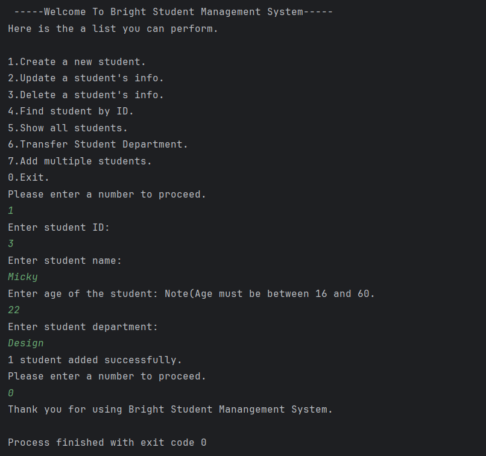
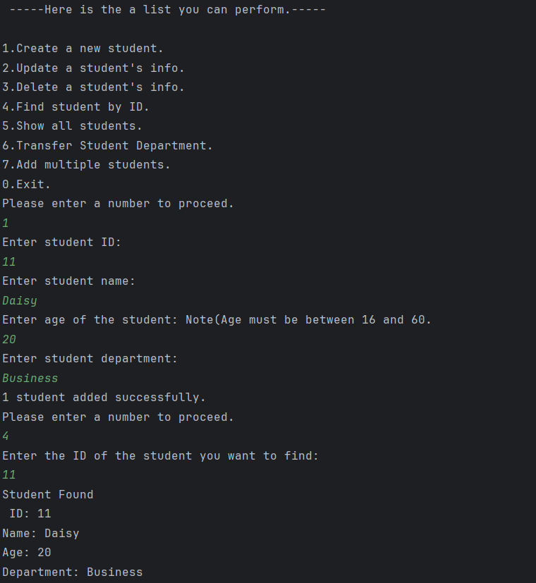
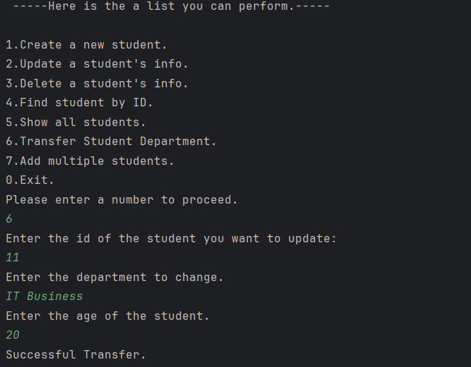
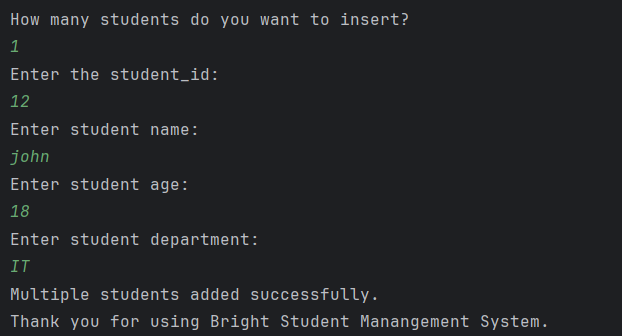

# Bright Student Management System

A Java-based Student Management System built using Core Java, JDBC, MySQL, and Maven. This project demonstrates database connectivity, CRUD operations, transaction management, exception handling, and batch processing.

## Overview

Bright Student Management System is a console-based application designed to manage student records efficiently. It allows users to perform student-related operations through a menu-driven interface while interacting with a MySQL relational database.

## Technologies Used

- Java
- JDBC (Java Database Connectivity)
- MySQL
- Maven
- IntelliJ IDEA

## Features

### 1. Student Management (CRUD)
- Create new student records.
- View all student records.
- Find students using their ID.
- Update existing student information.
- Delete student records.

### 2. Input Validation and Exception Handling
- Validates student age (16–60).
- Uses custom exceptions for invalid age and missing student records.
- Handles application errors.

### 3. Transaction Management
- Transfers students between departments.
- Uses database transactions.
- Implements commit and rollback to maintain data consistency.

### 4. Batch Processing
- Supports inserting multiple student records.
- Uses PreparedStatement batch operations to execute database insertions efficiently.

## Database Structure

Database: `student_db`

Table: `student`

| Column | Description |
|---|---|
| student_id | Student ID |
| name | Student name |
| age | Student age |
| department | Student department |

## Project Structure

The application follows a layered structure to separate responsibilities:

- Model: Represents student data.
- DAO: Handles database operations.
- Service: Contains application logic and validation.
- Main: Handles the menu-driven user interaction.

## Getting Started

### Prerequisites

- JDK compatible with the project configuration
- MySQL Server
- IntelliJ IDEA or another Java IDE
- Maven

### Installation

1. Clone this repository:

   ```bash
   git clone https://github.com/NErikaK/Bright-Student-Mangement-System.git
   ```

2. Open the project in IntelliJ IDEA.

3. Create a MySQL database named `student_db`.

4. Create the `student` table with the required columns.

5. Configure your MySQL connection details in the project's database configuration.

6. Reload Maven dependencies.

7. Run the application's main class.

## Learning Objectives

This project was developed to practise and strengthen practical Java backend development skills, including:

- Object-Oriented Programming
- JDBC and database connectivity
- SQL CRUD operations
- Layered application architecture
- Exception handling
- Transaction management
- Batch processing

  
## Application Screenshots

### Main Menu


### Create and Read Student


### Update and Delete Student


### Department Transfer


### Batch Insertion



## Author

Nang Eaindra Kyaw

Computer Science and Engineering Student

GitHub: https://github.com/NErikaK
